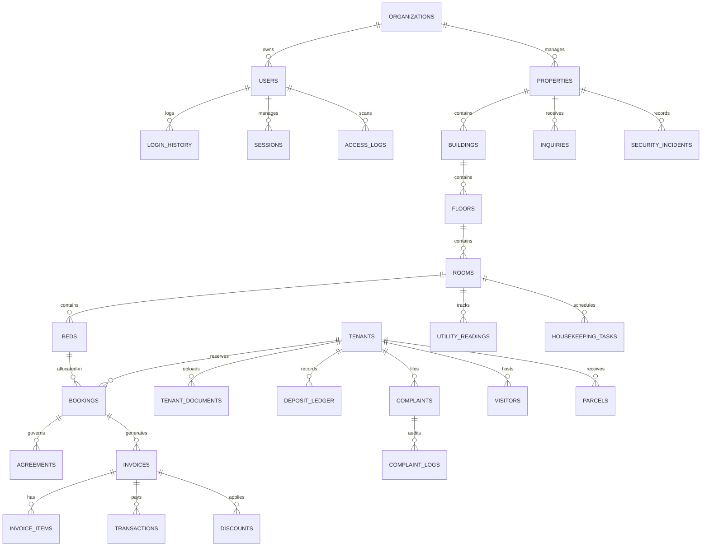

# StayEaze PostgreSQL Database Schema Design

This document details the PostgreSQL database schema design for the **StayEaze PG/Hostel Management SaaS Platform**. The schema includes DDL scripts, table definitions, relationships, indexing, and multi-tenant partitioning strategies.

---

## 1. ERD Overview (Mermaid)



---

## 2. Multi-Tenant Strategy
To ensure strict logical isolation between different PG organizations/tenants, we use a **shared-database, shared-schema, column-isolated** approach:
* Most top-level tables (e.g., `users`, `properties`, `tenants`, `inquiries`) contain an `org_id` column.
* Every query made by the application layer must include an `org_id` filter clause. (e.g., Spring Boot Hibernate filters will enforce this globally using `@FilterDef` or `@TenantId`).

---

## 3. SQL DDL Scripts & Schema Definitions

Here is the DDL blueprint for the active entities.

### Group A: Multi-Tenant & Identity Access Management (Auth)

```sql
-- Enable UUID extension if required
CREATE EXTENSION IF NOT EXISTS "uuid-ossp";

-- 1. Organizations (Tenants)
CREATE TABLE organizations (
    id UUID PRIMARY KEY DEFAULT uuid_generate_v4(),
    name VARCHAR(150) NOT NULL,
    subdomain VARCHAR(100) UNIQUE NOT NULL,
    status VARCHAR(50) DEFAULT 'ACTIVE' CHECK (status IN ('ACTIVE', 'SUSPENDED', 'DEACTIVATED')),
    created_at TIMESTAMP WITH TIME ZONE DEFAULT CURRENT_TIMESTAMP,
    updated_at TIMESTAMP WITH TIME ZONE DEFAULT CURRENT_TIMESTAMP
);

-- 2. Users Table
CREATE TABLE users (
    id UUID PRIMARY KEY DEFAULT uuid_generate_v4(),
    org_id UUID NOT NULL REFERENCES organizations(id) ON DELETE CASCADE,
    email VARCHAR(255) UNIQUE NOT NULL,
    password_hash VARCHAR(255) NOT NULL,
    mobile VARCHAR(20) UNIQUE NOT NULL,
    status VARCHAR(50) DEFAULT 'ACTIVE' CHECK (status IN ('ACTIVE', 'LOCKED', 'DEACTIVATED')),
    failed_attempts INT DEFAULT 0,
    locked_until TIMESTAMP WITH TIME ZONE,
    last_login TIMESTAMP WITH TIME ZONE,
    created_at TIMESTAMP WITH TIME ZONE DEFAULT CURRENT_TIMESTAMP,
    updated_at TIMESTAMP WITH TIME ZONE DEFAULT CURRENT_TIMESTAMP
);

-- 3. Roles Table
CREATE TABLE roles (
    id UUID PRIMARY KEY DEFAULT uuid_generate_v4(),
    name VARCHAR(50) NOT NULL CHECK (name IN ('SUPER_ADMIN', 'OWNER', 'PROPERTY_MANAGER', 'RECEPTIONIST', 'ACCOUNTANT', 'SECURITY_GUARD', 'STAFF', 'TENANT')),
    permissions JSONB NOT NULL -- List of authorized action keys
);

-- 4. User Roles Mapping
CREATE TABLE user_roles (
    user_id UUID REFERENCES users(id) ON DELETE CASCADE,
    role_id UUID REFERENCES roles(id) ON DELETE CASCADE,
    PRIMARY KEY (user_id, role_id)
);

-- 5. User Login History
CREATE TABLE login_history (
    id UUID PRIMARY KEY DEFAULT uuid_generate_v4(),
    user_id UUID REFERENCES users(id) ON DELETE CASCADE,
    ip_address VARCHAR(45),
    device_info VARCHAR(255),
    status VARCHAR(50) CHECK (status IN ('SUCCESS', 'FAILED')),
    timestamp TIMESTAMP WITH TIME ZONE DEFAULT CURRENT_TIMESTAMP
);

-- 6. User Sessions (Multi-device JWT tracking)
CREATE TABLE sessions (
    id UUID PRIMARY KEY DEFAULT uuid_generate_v4(),
    user_id UUID REFERENCES users(id) ON DELETE CASCADE,
    refresh_token VARCHAR(500) UNIQUE NOT NULL,
    device_id VARCHAR(150) NOT NULL,
    is_active BOOLEAN DEFAULT TRUE,
    expires_at TIMESTAMP WITH TIME ZONE NOT NULL,
    created_at TIMESTAMP WITH TIME ZONE DEFAULT CURRENT_TIMESTAMP
);
```

### Group B: Property & Inventory Management

```sql
-- 7. Properties
CREATE TABLE properties (
    id UUID PRIMARY KEY DEFAULT uuid_generate_v4(),
    org_id UUID NOT NULL REFERENCES organizations(id) ON DELETE CASCADE,
    name VARCHAR(150) NOT NULL,
    description TEXT,
    address TEXT NOT NULL,
    amenities VARCHAR(100)[] DEFAULT '{}', -- Array of standard amenities
    status VARCHAR(50) DEFAULT 'ACTIVE' CHECK (status IN ('ACTIVE', 'ARCHIVED')),
    currency VARCHAR(10) DEFAULT 'INR',
    timezone VARCHAR(50) DEFAULT 'Asia/Kolkata',
    created_at TIMESTAMP WITH TIME ZONE DEFAULT CURRENT_TIMESTAMP
);

-- 8. Buildings
CREATE TABLE buildings (
    id UUID PRIMARY KEY DEFAULT uuid_generate_v4(),
    property_id UUID NOT NULL REFERENCES properties(id) ON DELETE CASCADE,
    name VARCHAR(100) NOT NULL,
    code VARCHAR(20) NOT NULL,
    status VARCHAR(50) DEFAULT 'ACTIVE' CHECK (status IN ('ACTIVE', 'ARCHIVED')),
    CONSTRAINT unique_building_code_per_property UNIQUE(property_id, code)
);

-- 9. Floors
CREATE TABLE floors (
    id UUID PRIMARY KEY DEFAULT uuid_generate_v4(),
    building_id UUID NOT NULL REFERENCES buildings(id) ON DELETE CASCADE,
    floor_number INT NOT NULL,
    status VARCHAR(50) DEFAULT 'ACTIVE' CHECK (status IN ('ACTIVE', 'MAINTENANCE')),
    CONSTRAINT unique_floor_per_building UNIQUE(building_id, floor_number)
);

-- 10. Rooms
CREATE TABLE rooms (
    id UUID PRIMARY KEY DEFAULT uuid_generate_v4(),
    floor_id UUID NOT NULL REFERENCES floors(id) ON DELETE CASCADE,
    room_number VARCHAR(20) NOT NULL,
    sharing_type VARCHAR(50) NOT NULL CHECK (sharing_type IN ('SINGLE', 'DOUBLE', 'TRIPLE', 'FOUR_SHARING', 'DORMITORY')),
    base_rent DECIMAL(12, 2) NOT NULL,
    status VARCHAR(50) DEFAULT 'AVAILABLE' CHECK (status IN ('AVAILABLE', 'BLOCKED', 'MAINTENANCE')),
    amenities VARCHAR(100)[] DEFAULT '{}',
    CONSTRAINT unique_room_per_floor UNIQUE(floor_id, room_number)
);

-- 11. Beds
CREATE TABLE beds (
    id UUID PRIMARY KEY DEFAULT uuid_generate_v4(),
    room_id UUID NOT NULL REFERENCES rooms(id) ON DELETE CASCADE,
    bed_number VARCHAR(20) NOT NULL,
    status VARCHAR(50) DEFAULT 'AVAILABLE' CHECK (status IN ('AVAILABLE', 'RESERVED', 'OCCUPIED', 'MAINTENANCE')),
    qr_code VARCHAR(150) UNIQUE,
    CONSTRAINT unique_bed_per_room UNIQUE(room_id, bed_number)
);
```

### Group C: Inquiry & Tenant Lifecycle Management

```sql
-- 12. Inquiries (Leads)
CREATE TABLE inquiries (
    id UUID PRIMARY KEY DEFAULT uuid_generate_v4(),
    org_id UUID NOT NULL REFERENCES organizations(id) ON DELETE CASCADE,
    property_id UUID REFERENCES properties(id) ON DELETE SET NULL,
    name VARCHAR(150) NOT NULL,
    email VARCHAR(255),
    mobile VARCHAR(20) NOT NULL,
    gender VARCHAR(10) CHECK (gender IN ('MALE', 'FEMALE', 'OTHER')),
    preferred_sharing VARCHAR(50),
    expected_move_in_date DATE,
    source VARCHAR(50),
    status VARCHAR(50) DEFAULT 'NEW' CHECK (status IN ('NEW', 'ASSIGNED', 'VISIT_SCHEDULED', 'CONVERTED', 'LOST')),
    assigned_to UUID REFERENCES users(id) ON DELETE SET NULL,
    created_at TIMESTAMP WITH TIME ZONE DEFAULT CURRENT_TIMESTAMP
);

-- 13. Tenants Profiles
CREATE TABLE tenants (
    id UUID PRIMARY KEY DEFAULT uuid_generate_v4(),
    org_id UUID NOT NULL REFERENCES organizations(id) ON DELETE CASCADE,
    first_name VARCHAR(100) NOT NULL,
    last_name VARCHAR(100) NOT NULL,
    email VARCHAR(255),
    mobile VARCHAR(20) UNIQUE NOT NULL,
    gender VARCHAR(10) CHECK (gender IN ('MALE', 'FEMALE', 'OTHER')),
    kyc_status VARCHAR(50) DEFAULT 'PENDING' CHECK (kyc_status IN ('PENDING', 'VERIFIED', 'REJECTED')),
    emergency_contact_name VARCHAR(150),
    emergency_contact_mobile VARCHAR(20),
    status VARCHAR(50) DEFAULT 'ACTIVE' CHECK (status IN ('ACTIVE', 'CHECKED_OUT', 'BLACKLISTED')),
    created_at TIMESTAMP WITH TIME ZONE DEFAULT CURRENT_TIMESTAMP
);

-- 14. KYC Documents
CREATE TABLE tenant_documents (
    id UUID PRIMARY KEY DEFAULT uuid_generate_v4(),
    tenant_id UUID NOT NULL REFERENCES tenants(id) ON DELETE CASCADE,
    doc_type VARCHAR(50) NOT NULL CHECK (doc_type IN ('AADHAAR', 'PAN', 'PASSPORT', 'VOTER_ID', 'EMPLOYEE_ID', 'STUDENT_ID')),
    file_path VARCHAR(500) NOT NULL,
    status VARCHAR(50) DEFAULT 'PENDING' CHECK (status IN ('PENDING', 'APPROVED', 'REJECTED')),
    verified_by UUID REFERENCES users(id),
    created_at TIMESTAMP WITH TIME ZONE DEFAULT CURRENT_TIMESTAMP
);

-- 15. Bookings (Beds allocations)
CREATE TABLE bookings (
    id UUID PRIMARY KEY DEFAULT uuid_generate_v4(),
    tenant_id UUID NOT NULL REFERENCES tenants(id) ON DELETE CASCADE,
    bed_id UUID REFERENCES beds(id) ON DELETE SET NULL,
    checkin_date DATE NOT NULL,
    checkout_date DATE,
    rent_agreed DECIMAL(12, 2) NOT NULL,
    deposit_agreed DECIMAL(12, 2) NOT NULL,
    status VARCHAR(50) DEFAULT 'CONFIRMED' CHECK (status IN ('CONFIRMED', 'CHECKED_OUT', 'CANCELLED')),
    created_at TIMESTAMP WITH TIME ZONE DEFAULT CURRENT_TIMESTAMP
);

-- 16. Rental Agreements
CREATE TABLE agreements (
    id UUID PRIMARY KEY DEFAULT uuid_generate_v4(),
    booking_id UUID NOT NULL REFERENCES bookings(id) ON DELETE CASCADE,
    start_date DATE NOT NULL,
    end_date DATE NOT NULL,
    doc_path VARCHAR(500) NOT NULL,
    signature_path VARCHAR(500),
    status VARCHAR(50) DEFAULT 'PENDING_SIGNATURE' CHECK (status IN ('PENDING_SIGNATURE', 'ACTIVE', 'EXPIRED')),
    created_at TIMESTAMP WITH TIME ZONE DEFAULT CURRENT_TIMESTAMP
);

-- 17. Bed/Room Transfers History
CREATE TABLE tenant_transfers (
    id UUID PRIMARY KEY DEFAULT uuid_generate_v4(),
    tenant_id UUID NOT NULL REFERENCES tenants(id) ON DELETE CASCADE,
    from_bed_id UUID REFERENCES beds(id) ON DELETE SET NULL,
    to_bed_id UUID REFERENCES beds(id) ON DELETE SET NULL,
    transfer_date DATE DEFAULT CURRENT_DATE,
    reason TEXT,
    created_at TIMESTAMP WITH TIME ZONE DEFAULT CURRENT_TIMESTAMP
);

-- 18. Checkout Inspections & Damages
CREATE TABLE checkout_inspections (
    id UUID PRIMARY KEY DEFAULT uuid_generate_v4(),
    booking_id UUID NOT NULL REFERENCES bookings(id) ON DELETE CASCADE,
    inspector_id UUID REFERENCES users(id) ON DELETE SET NULL,
    inspection_date DATE DEFAULT CURRENT_DATE,
    damage_cost DECIMAL(12, 2) DEFAULT 0.00,
    remarks TEXT,
    created_at TIMESTAMP WITH TIME ZONE DEFAULT CURRENT_TIMESTAMP
);
```

### Group D: Rent & Invoicing

```sql
-- 19. Rent Plans
CREATE TABLE rent_plans (
    id UUID PRIMARY KEY DEFAULT uuid_generate_v4(),
    property_id UUID NOT NULL REFERENCES properties(id) ON DELETE CASCADE,
    name VARCHAR(100) NOT NULL,
    monthly_rent DECIMAL(12, 2) NOT NULL,
    security_deposit DECIMAL(12, 2) NOT NULL,
    utility_rules JSONB DEFAULT '{}', -- Custom configuration rules for sub-meter calculations
    is_active BOOLEAN DEFAULT TRUE
);

-- 20. Invoices (Monthly recurring or utility statements)
CREATE TABLE invoices (
    id UUID PRIMARY KEY DEFAULT uuid_generate_v4(),
    booking_id UUID NOT NULL REFERENCES bookings(id) ON DELETE CASCADE,
    invoice_number VARCHAR(100) UNIQUE NOT NULL,
    billing_period_start DATE NOT NULL,
    billing_period_end DATE NOT NULL,
    due_date DATE NOT NULL,
    total_amount DECIMAL(12, 2) NOT NULL,
    balance_amount DECIMAL(12, 2) NOT NULL,
    status VARCHAR(50) DEFAULT 'UNPAID' CHECK (status IN ('UNPAID', 'PARTIALLY_PAID', 'PAID', 'OVERDUE', 'CANCELLED')),
    created_at TIMESTAMP WITH TIME ZONE DEFAULT CURRENT_TIMESTAMP
);

-- 21. Invoice Line Items
CREATE TABLE invoice_items (
    id UUID PRIMARY KEY DEFAULT uuid_generate_v4(),
    invoice_id UUID NOT NULL REFERENCES invoices(id) ON DELETE CASCADE,
    charge_type VARCHAR(100) NOT NULL CHECK (charge_type IN ('ROOM_RENT', 'ELECTRICITY', 'WATER', 'INTERNET', 'LATE_FEE', 'DAMAGE_FEE', 'OTHER')),
    amount DECIMAL(12, 2) NOT NULL,
    description VARCHAR(255)
);

-- 22. Sub-meter Utility Readings
CREATE TABLE utility_readings (
    id UUID PRIMARY KEY DEFAULT uuid_generate_v4(),
    room_id UUID NOT NULL REFERENCES rooms(id) ON DELETE CASCADE,
    reading_date DATE NOT NULL,
    meter_reading DECIMAL(10, 2) NOT NULL,
    calculated_amount DECIMAL(12, 2) NOT NULL,
    created_at TIMESTAMP WITH TIME ZONE DEFAULT CURRENT_TIMESTAMP
);

-- 23. Invoice Discounts
CREATE TABLE discounts (
    id UUID PRIMARY KEY DEFAULT uuid_generate_v4(),
    invoice_id UUID NOT NULL REFERENCES invoices(id) ON DELETE CASCADE,
    discount_type VARCHAR(50) NOT NULL CHECK (discount_type IN ('PROMOTIONAL', 'SCHOLARSHIP', 'EMPLOYEE', 'MANUAL_WAIVER')),
    amount DECIMAL(12, 2) NOT NULL,
    remarks TEXT
);

-- 24. Transactions (Rent Payments)
CREATE TABLE transactions (
    id UUID PRIMARY KEY DEFAULT uuid_generate_v4(),
    invoice_id UUID NOT NULL REFERENCES invoices(id) ON DELETE CASCADE,
    transaction_number VARCHAR(100) UNIQUE NOT NULL,
    amount DECIMAL(12, 2) NOT NULL,
    payment_mode VARCHAR(50) CHECK (payment_mode IN ('CASH', 'BANK_TRANSFER', 'QR_CODE_OFFLINE', 'ONLINE_MOCK')),
    payment_status VARCHAR(50) DEFAULT 'COMPLETED' CHECK (payment_status IN ('PENDING', 'COMPLETED', 'FAILED')),
    reference_number VARCHAR(150),
    created_at TIMESTAMP WITH TIME ZONE DEFAULT CURRENT_TIMESTAMP
);

-- 25. Deposit Ledger (Security Deposit holdings)
CREATE TABLE deposit_ledger (
    id UUID PRIMARY KEY DEFAULT uuid_generate_v4(),
    tenant_id UUID NOT NULL REFERENCES tenants(id) ON DELETE CASCADE,
    type VARCHAR(50) NOT NULL CHECK (type IN ('COLLECTION', 'ADJUSTMENT', 'REFUND', 'FORFEITURE')),
    amount DECIMAL(12, 2) NOT NULL,
    reference_id UUID, -- References booking or checkout_inspection
    remarks TEXT,
    created_at TIMESTAMP WITH TIME ZONE DEFAULT CURRENT_TIMESTAMP
);
```

### Group E: Operations & safety

```sql
-- 26. Complaints
CREATE TABLE complaints (
    id UUID PRIMARY KEY DEFAULT uuid_generate_v4(),
    tenant_id UUID NOT NULL REFERENCES tenants(id) ON DELETE CASCADE,
    category VARCHAR(100) NOT NULL CHECK (category IN ('ELECTRICAL', 'PLUMBING', 'INTERNET', 'FURNITURE', 'HOUSEKEEPING', 'FOOD', 'WATER', 'SECURITY', 'NOISE', 'PEST_CONTROL', 'OTHER')),
    description TEXT NOT NULL,
    urgency_level VARCHAR(50) NOT NULL CHECK (urgency_level IN ('LOW', 'MEDIUM', 'HIGH', 'CRITICAL')),
    status VARCHAR(50) DEFAULT 'OPEN' CHECK (status IN ('OPEN', 'ASSIGNED', 'WORK_IN_PROGRESS', 'RESOLVED', 'CLOSED')),
    assigned_staff_id UUID REFERENCES users(id) ON DELETE SET NULL,
    created_at TIMESTAMP WITH TIME ZONE DEFAULT CURRENT_TIMESTAMP,
    resolved_at TIMESTAMP WITH TIME ZONE
);

-- 27. Complaint Timeline Logs
CREATE TABLE complaint_logs (
    id UUID PRIMARY KEY DEFAULT uuid_generate_v4(),
    complaint_id UUID NOT NULL REFERENCES complaints(id) ON DELETE CASCADE,
    status_from VARCHAR(50) NOT NULL,
    status_to VARCHAR(50) NOT NULL,
    remarks TEXT,
    changed_by UUID REFERENCES users(id),
    timestamp TIMESTAMP WITH TIME ZONE DEFAULT CURRENT_TIMESTAMP
);

-- 28. Housekeeping Schedules
CREATE TABLE housekeeping_tasks (
    id UUID PRIMARY KEY DEFAULT uuid_generate_v4(),
    room_id UUID NOT NULL REFERENCES rooms(id) ON DELETE CASCADE,
    staff_id UUID REFERENCES users(id) ON DELETE SET NULL,
    scheduled_date DATE NOT NULL,
    status VARCHAR(50) DEFAULT 'SCHEDULED' CHECK (status IN ('SCHEDULED', 'IN_PROGRESS', 'CLEANED', 'INSPECTED', 'RECLEAN_REQUESTED')),
    checklist VARCHAR(100)[] DEFAULT '{}',
    remarks TEXT,
    updated_at TIMESTAMP WITH TIME ZONE DEFAULT CURRENT_TIMESTAMP
);

-- 29. Visitors Logs
CREATE TABLE visitors (
    id UUID PRIMARY KEY DEFAULT uuid_generate_v4(),
    tenant_id UUID NOT NULL REFERENCES tenants(id) ON DELETE CASCADE,
    name VARCHAR(150) NOT NULL,
    mobile VARCHAR(20) NOT NULL,
    purpose TEXT,
    qr_pass_code VARCHAR(100) UNIQUE,
    checkin_time TIMESTAMP WITH TIME ZONE,
    checkout_time TIMESTAMP WITH TIME ZONE,
    status VARCHAR(50) DEFAULT 'PENDING_APPROVAL' CHECK (status IN ('PENDING_APPROVAL', 'APPROVED', 'REJECTED', 'ACTIVE', 'CHECKED_OUT')),
    created_at TIMESTAMP WITH TIME ZONE DEFAULT CURRENT_TIMESTAMP
);

-- 30. Tenant Parcels Tracking
CREATE TABLE parcels (
    id UUID PRIMARY KEY DEFAULT uuid_generate_v4(),
    tenant_id UUID NOT NULL REFERENCES tenants(id) ON DELETE CASCADE,
    courier_name VARCHAR(100) NOT NULL,
    status VARCHAR(50) DEFAULT 'RECEIVED' CHECK (status IN ('RECEIVED', 'COLLECTED')),
    received_at TIMESTAMP WITH TIME ZONE DEFAULT CURRENT_TIMESTAMP,
    collected_at TIMESTAMP WITH TIME ZONE,
    remarks TEXT
);

-- 31. Security Incidents
CREATE TABLE security_incidents (
    id UUID PRIMARY KEY DEFAULT uuid_generate_v4(),
    property_id UUID NOT NULL REFERENCES properties(id) ON DELETE CASCADE,
    description TEXT NOT NULL,
    reported_by UUID REFERENCES users(id),
    reported_at TIMESTAMP WITH TIME ZONE DEFAULT CURRENT_TIMESTAMP,
    status VARCHAR(50) DEFAULT 'OPEN' CHECK (status IN ('OPEN', 'INVESTIGATING', 'RESOLVED'))
);

-- 32. Physical Access Control Logs
CREATE TABLE access_logs (
    id UUID PRIMARY KEY DEFAULT uuid_generate_v4(),
    user_id UUID REFERENCES users(id) ON DELETE SET NULL,
    entry_point VARCHAR(100) NOT NULL,
    status VARCHAR(50) NOT NULL CHECK (status IN ('ALLOWED', 'DENIED')),
    timestamp TIMESTAMP WITH TIME ZONE DEFAULT CURRENT_TIMESTAMP
);
```

---

## 4. Key Relational Indexes
To optimize standard operations and tenant isolation, the following indexes are specified:

```sql
-- Tenant Isolation Filters
CREATE INDEX idx_users_org ON users(org_id);
CREATE INDEX idx_properties_org ON properties(org_id);
CREATE INDEX idx_tenants_org ON tenants(org_id);
CREATE INDEX idx_inquiries_org ON inquiries(org_id);

-- Inventory Walkups
CREATE INDEX idx_buildings_property ON buildings(property_id);
CREATE INDEX idx_floors_building ON floors(building_id);
CREATE INDEX idx_rooms_floor ON rooms(floor_id);
CREATE INDEX idx_beds_room ON beds(room_id);

-- Active Bookings Search
CREATE INDEX idx_bookings_tenant ON bookings(tenant_id);
CREATE INDEX idx_bookings_bed ON bookings(bed_id);
CREATE INDEX idx_bookings_status ON bookings(status);

-- Financial Operations
CREATE INDEX idx_invoices_booking ON invoices(booking_id);
CREATE INDEX idx_invoices_status ON invoices(status);
CREATE INDEX idx_transactions_invoice ON transactions(invoice_id);

-- Operations Tickets
CREATE INDEX idx_complaints_tenant ON complaints(tenant_id);
CREATE INDEX idx_complaints_status ON complaints(status);
CREATE INDEX idx_housekeeping_room ON housekeeping_tasks(room_id);
CREATE INDEX idx_visitors_tenant ON visitors(tenant_id);
```
